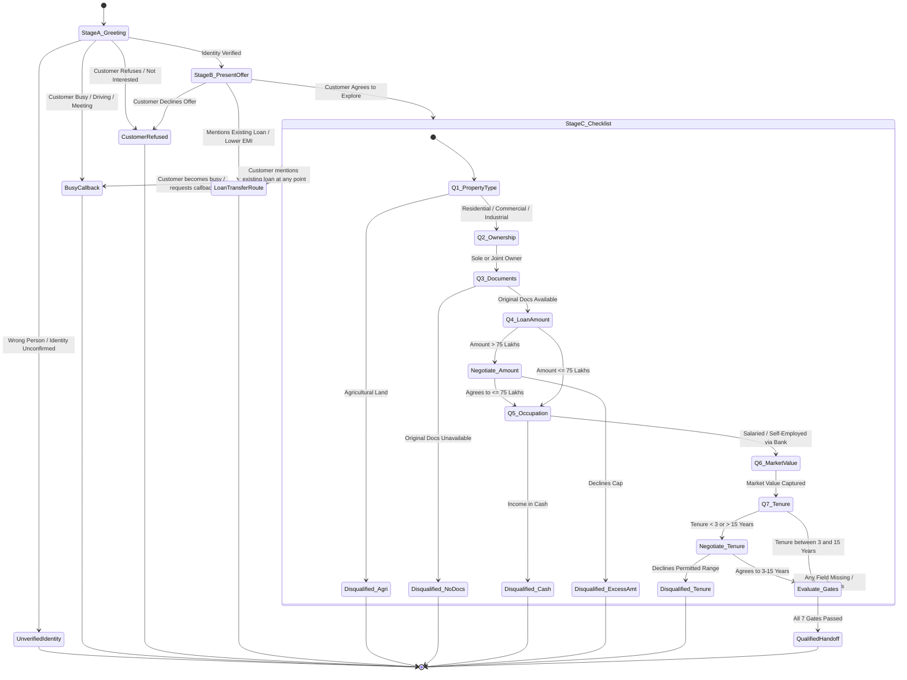

# Home Credit LAP Voice Agent — Conversation Flows & State Transitions

This document details the conversational state machine, branching decisions, memory-driven skipping rules, and terminal outcomes for the Home Credit Loan Against Property (LAP) Voice Agent.

---

## 1. High-Level Conversation Lifecycle (State Diagram)



---

## 2. Detailed Decision Flowchart

```mermaid
flowchart TD
    Start([Inbound Call Trigger / Outbound Dial]) --> A1[Stage A: Greet Customer & Verify Identity]
    
    A1 --> A2{Who Answered?}
    A2 -- Wrong Person / Unavailable --> A_Term1[Politely Terminate: unverified_identity_terminated]
    A2 -- Busy / Driving / Meeting --> A_Busy[Ask preferred callback time]
    A_Busy --> A_Term2[Schedule Callback: busy_callback_scheduled]
    A2 -- Customer Refuses Call --> A_Term3[Polite Opt-Out: customer_refused]
    A2 -- Correct Customer Confirmed --> B1[Stage B: Present LAP Offer up to ₹75 Lakhs]

    B1 --> B2{Customer Response to Offer}
    B2 -- Decline / Not Interested --> B_Term1[Polite Exit: customer_refused]
    B2 -- Wants to Transfer Existing Loan / Reduce EMI --> TransferRoute[Route to Loan Transfer Specialist: loan_transfer_referral]
    B2 -- Interested / Agrees --> C_Init[Stage C: Check Memory & Ask Earliest Unanswered Question]

    %% Out-of-Order Memory Check Loop
    C_Init --> MemCheck{Are all 7 fields answered and valid?}
    MemCheck -- YES --> StrictGateCheck
    MemCheck -- NO --> NextField[Select Earliest Unanswered Field]

    %% Q1 Property Type
    NextField -- Q1: Property Type --> Q1_Eval{Property Type}
    Q1_Eval -- Agricultural --> Disq_Agri[Disqualify: disqualified_agricultural]
    Q1_Eval -- Residential / Commercial / Industrial --> Q1_Save[Save property_type -> Update Memory] --> MemCheck
    Q1_Eval -- Ambiguous Multiple --> Q1_Clarify[Clarify Collateral Property] --> Q1_Eval

    %% Q2 Ownership Status
    NextField -- Q2: Ownership Status --> Q2_Eval{Ownership}
    Q2_Eval -- Sole / Joint --> Q2_Save[Save ownership_status -> Update Memory] --> MemCheck

    %% Q3 Original Documents
    NextField -- Q3: Original Documents --> Q3_Eval{Originals Ready?}
    Q3_Eval -- Unavailable / Lost --> Disq_Docs[Disqualify: disqualified_no_documents]
    Q3_Eval -- Photocopies / Soft Copy --> Q3_Clarify[Clarify physical originals requirement] --> Q3_Eval
    Q3_Eval -- Available --> Q3_Save[Save original_documents -> Update Memory] --> MemCheck

    %% Q4 Requested Loan Amount
    NextField -- Q4: Loan Amount --> Q4_Eval{Loan Amount}
    Q4_Eval -- Amount <= 75 Lakhs --> Q4_Save[Save loan_amount -> Update Memory] --> MemCheck
    Q4_Eval -- Amount > 75 Lakhs --> Q4_Nego{Explain ₹75L cap. Agree to <= 75L?}
    Q4_Nego -- Customer Agrees --> Q4_SaveRevised[Save revised amount <= 75L] --> MemCheck
    Q4_Nego -- Customer Declines --> Disq_Amt[Disqualify: disqualified_excess_amount]

    %% Q5 Occupation & Income Mode
    NextField -- Q5: Occupation & Mode --> Q5_Eval{Income Receipt Mode}
    Q5_Eval -- Cash Income --> Disq_Cash[Disqualify: disqualified_cash_income]
    Q5_Eval -- Salaried / Self-Employed via Bank --> Q5_Save[Save occupation & bank mode] --> MemCheck
    Q5_Eval -- Mixed / Ambiguous --> Q5_Clarify[Clarify verifiable bank deposit] --> Q5_Eval

    %% Q6 Property Market Value
    NextField -- Q6: Market Value --> Q6_Save[Save market_value -> Update Memory] --> MemCheck

    %% Q7 Requested Tenure
    NextField -- Q7: Tenure Years --> Q7_Eval{Tenure between 3 and 15 years?}
    Q7_Eval -- 3 to 15 Years --> Q7_Save[Save tenure_years -> Update Memory] --> MemCheck
    Q7_Eval -- <3 or >15 Years --> Q7_Nego{Explain 3-15y range. Agree to revise?}
    Q7_Nego -- Customer Agrees --> Q7_SaveRevised[Save revised tenure in [3,15]] --> MemCheck
    Q7_Nego -- Customer Declines --> Disq_Tenure[Disqualify: disqualified_invalid_tenure]

    %% Strict Gate
    StrictGateCheck{Strict Handoff Gates Passed?}
    StrictGateCheck -- ALL 7 Valid & Fresh Loan --> HandoffSuccess[Confirm Expert Callback: qualified_handoff]
    StrictGateCheck -- Any Missing / Ineligible --> NextField
```

---

## 3. Terminal Outcomes & State Isolation Rules

| Outcome Identifier | Category | Trigger Condition | Final Agent Action |
| :--- | :--- | :--- | :--- |
| `qualified_handoff` | **Success** | All 7 checklist data points captured, fully verified, no disqualification active, fresh loan requested. | Congratulates customer, informs that a senior loan expert will call back with customized interest rates, closes call. |
| `disqualified_agricultural` | **Disqualification** | Customer offers agricultural land as collateral. | Explains that only residential, commercial, or industrial properties are eligible for this offer. Closes call respectfully. |
| `disqualified_no_documents` | **Disqualification** | Customer confirms original documents are unavailable or missing. | Explains that physical original documents are mandatory for verification. Closes call politely. |
| `disqualified_cash_income` | **Disqualification** | Customer receives income in cash. | Explains that verifiable income deposited into a bank account is mandatory. Closes call politely. |
| `disqualified_excess_amount` | **Disqualification** | Customer requests > ₹75,00,000 and declines to proceed with ₹75 Lakhs or less. | Explains offer limit is strictly ₹75 Lakhs. Ends call without qualifying. |
| `disqualified_invalid_tenure` | **Disqualification** | Customer requests < 3 or > 15 years and declines to select within 3-15 years. | Explains tenure must be between 3 and 15 years. Ends call without qualifying. |
| `loan_transfer_referral` | **Routing** | Customer mentions existing loan on property, desire to transfer, or reduce EMI. | Ceases fresh-loan checklist, confirms senior loan transfer specialist will contact them shortly, ends call. |
| `busy_callback_scheduled` | **Call Control** | Customer reports driving, meeting, or being busy. | Captures preferred callback date/time, acknowledges situation, ends call politely. |
| `customer_refused` | **Call Control** | Customer declines offer or requests not to be contacted. | Acknowledges opt-out respectfully, records preference, ends call without pressure. |
| `unverified_identity_terminated` | **Call Control** | Wrong number, third party unable to transfer to customer. | Does not disclose offer or financial details. Apologizes and closes call. |

### Terminal State Isolation Rule
Once a conversation reaches ANY of the terminal outcomes above:
1. The state machine transitions to terminal mode.
2. Under no circumstance will subsequent customer utterances re-open the qualification checklist or convert a disqualified/transfer lead into a `qualified_handoff`.
